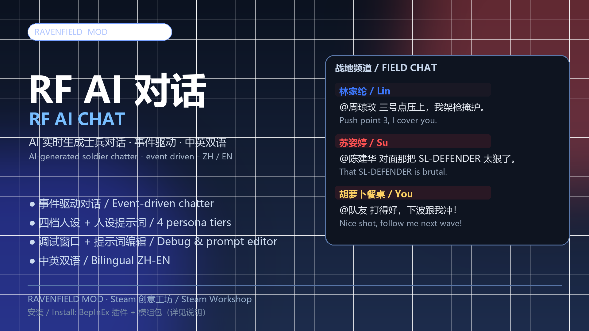

# RF AI 对话（RF AI Chat）— Ravenfield AI 聊天 MOD

> 让 Ravenfield 里的 AI 士兵用真实 LLM 实时开麦：事件驱动对话、四档人设、@点名接话、战报播报、调试窗口、中英双语。
> AI soldiers actually talk, generated live by a real LLM: event-driven chatter, four persona tiers,
> @-mention replies, battle reports, debug console, ZH/EN bilingual.



## 功能 / Features

- **事件驱动对话**：击杀、阵亡、友伤、多杀、据点、指令、载具、玩家发言等事件自动触发
- **四档人设**：按 KD 名次分位数分配 新兵/老兵/精锐/王牌
- **@ 点名链**：AI 之间互相 @，被点名必回
- **玩家相关插队**：击杀玩家/被玩家击杀/被点名等优先插队上屏
- **战报系统**：手动 + 自动战报（间隔可调），含 KD 前三/复活票/比分
- **系统播报回应**：每队至少 5 名 AI 回应播报；开局/胜负播报
- **调试窗口**：每条台词的原因/对象/人设/耗时/原始响应，可导出
- **提示词体系**：全局/阵营/对局/角色 四层提示词 + 常识库，均可在设置内编辑
- **中英双语**：台词语言可切中文/English；设置界面固定中英双语

- **Event-driven dialogue**: kills, deaths, team-kills, multi-kills, captures, orders, vehicles, player chat
- **Four persona tiers** by KD percentile: Rookie / Veteran / Elite / Ace
- **@-mention chains**: soldiers mention each other and always reply when mentioned
- **Player-priority events**: events involving the player jump the queue
- **Battle reports**: manual + automatic (interval configurable), top-3 KD / tickets / score
- **System broadcast reactions**: at least 5 AI per team react; opening + result broadcasts
- **Debug console**: reason/target/persona/latency/raw response, exportable
- **Prompt layers**: global / faction / match / character + knowledge base, editable in settings
- **Bilingual**: dialogue language switchable; settings UI always ZH/EN

## 安装 / Installation

1. 安装 **BepInEx 5.4.23.5**（Ravenfield 版）；
2. 下载 [Releases](../../releases) 里的安装包，解压到游戏根目录（合并覆盖）：
   - `BepInEx/plugins/RF.AiChat/RF.AiChat.dll`
   - `ravenfield_Data/mods/RFAiChatUI/RFAiChatUI.rfc`
   - `ravenfield_Data/mods/RFAiChatUI/icon.png`
3. 启动游戏 → 模组 → 勾选「RF AI 对话」→ 设置里填入**你自己的** API Key（OpenAI 兼容接口，默认 DeepSeek）；
4. 进对局，按 `Y` 调出输入框。

>> 详细图文见 `docs/安装教程-中文版.pdf` / `docs/Installation-Guide-EN.pdf`。
>> 本 MOD 不内置任何 API Key；Key 由玩家自行填写，仅保存在本机配置中。

## 构建 / Build

> 需要：Windows + .NET Framework 4.x（自带 csc）+ Ravenfield + BepInEx 5.4.23.5。
> 仓库不包含 `.rfc` 载体（版权原因），构建模组包需要自备一个可用的 Mutator `.rfc` 作为载体。

```bash
# 1) 编译插件（会部署到你设置的 RAVENFIELD_DIR）
export RAVENFIELD_DIR="/c/Program Files (x86)/Steam/steamapps/common/Ravenfield"
bash 20-源码/plugin/build.sh

# 2) 跑静态检查 + Lua 冒烟测试（需要 pip install -r requirements.txt）
bash 20-源码/tools/run_checks.sh
```

## 目录结构 / Layout

```
20-源码/plugin/        C# BepInEx 插件源码
20-源码/lua/           Ravenscript（Lua）脚本源码
20-源码/tools/         构建/测试/打包工具
docs/                  安装教程、开发说明、创意工坊文案、图片
```

## 开发说明 / Development

- 插件：BepInEx 5.4.23.5 + .NET Framework 4.x，C# 5；入口 `AiChatPlugin.cs`；
  显示层 `OverlayChat.cs`；引擎 `ChatEngine.cs`；接口桥 `AiChatBridgeApi.cs`。
- 脚本：Ravenscript（MoonSharp），入口 `RFAiChat.lua`；与插件之间用行协议通信。
- 更多细节见 `docs/开发与构建说明.md`。

## 致谢 / Credits

- **Ravenfield** © SteelRaven7（本 MOD 非官方作品，与 SteelRaven7 无关）
- **BepInEx**（插件加载框架）
- **Chat Feed** 原型（早期社区 Mutator，本 MOD 的 UI/载体思路受其启发）
- 所有参与测试与反馈的玩家

## 协议 / License

MIT License，见 [LICENSE](LICENSE)。

> 本项目按"现状"提供，不附带任何担保；使用第三方 API 产生的费用与合规责任由使用者自行承担。
> This project is provided "as is", without warranty of any kind.
